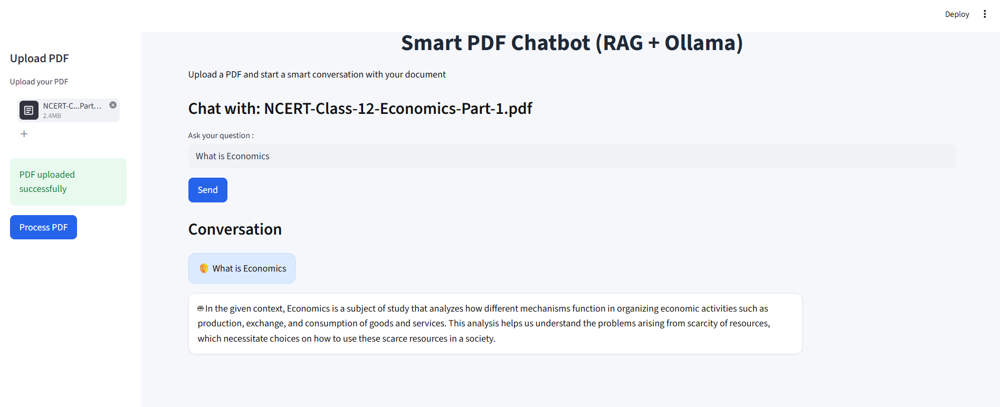
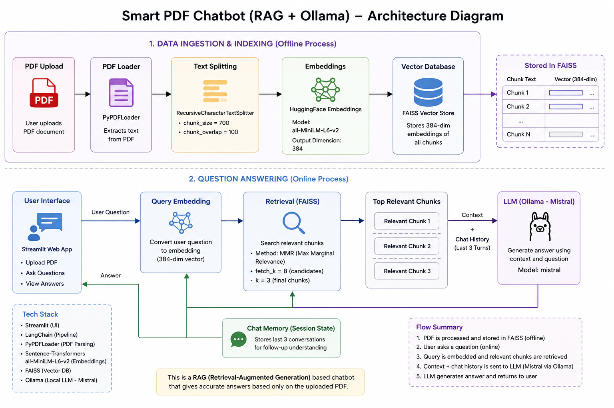

#  Smart PDF Chatbot (RAG + Ollama)

A **Retrieval-Augmented Generation (RAG)** based AI chatbot that allows users to upload any PDF and interact with it in a conversational way.
Built using **Streamlit, LangChain, FAISS, HuggingFace embeddings, and Ollama (local LLM)**.

---
<p align="center">
  
</p>

---

##  Features

-  Upload any PDF document
-  AI understands document content using embeddings
-  Chat with your PDF like a personal assistant
-  Context-aware answers using FAISS retrieval
-  Supports follow-up questions (memory enabled)
-  Runs locally using Ollama (no API cost)

---

##  Tech Stack

- Streamlit (Frontend UI)
- LangChain (RAG pipeline)
- FAISS (Vector database)
- HuggingFace Transformers (Embeddings)
- SentenceTransformers (all-MiniLM-L6-v2)
- Ollama (Local LLM - Mistral)
- PyPDF (PDF parsing)

---

## System Architecture

The following diagram explains the end-to-end workflow of the Smart PDF Chatbot using RAG and Ollama.



---

##  Setup Guide

### 1️ Clone the repository
```bash
git clone https://github.com/Ravi506051/RAG-based-PDF-chatbot-main.git
cd RAG-based-PDF-chatbot-main
```

### 2. Create and activate virtual environment

```bash
For Windows :
python -m venv venv
venv\Scripts\activate
```

### 3. Install Dependencies
```bash
pip install -r requirements.txt
```

### 4. Install Ollama (IMPORTANT)
Download Ollama:
 https://ollama.com

Then pull the model:
```bash
ollama pull mistral
```

Run Ollama (keep it running in background):
```bash
ollama run mistral
```
### 5. Run the Application
```bash
streamlit run app.py
```


## 🚀 Future Improvements

- Support multiple PDF documents in a single conversation
- Improve semantic search and document retrieval quality
- Add source references so users can verify answers against the original PDF
- Improve handling of long and complex documents
- Add chat history and a more user-friendly interface

## 🧪 Testing and Evaluation

Test the chatbot using PDFs with different topics and lengths. Ask factual questions, compare generated answers with the original document, and check whether the retrieved passages are relevant.

Useful evaluation measures include retrieval precision, answer relevance, and faithfulness to the source document.

## ⚠️ Limitations

- Answer quality depends on the quality of PDF text extraction and retrieval.
- Scanned PDFs may require OCR support.
- AI-generated answers should be checked against the original document.

## 👨‍💻 Project Maintainer

Ravi Kumar Rao

GitHub: https://github.com/Ravi506051

## Retrieval Quality Checklist

- Test questions whose answers are clearly present, partially present, and absent from the uploaded PDF.
- Inspect retrieved chunks to confirm that the answer is grounded in relevant passages.
- Tune chunk size and overlap using a small, repeatable evaluation set rather than assuming one configuration works for every document.
- Verify that follow-up questions do not silently use irrelevant context from earlier documents.

## Privacy and Limitations

Documents may contain confidential information. Run the application only with files you are authorized to process, understand where embeddings and chat history are stored, and avoid exposing uploaded content in logs or public deployments. Generated answers can be incomplete or incorrect; verify important claims against the source PDF.

## Project Development Notes

Evaluate retrieval and answer faithfulness separately. Test questions answered by the PDF, absent from the PDF, and requiring follow-up; verify citations against source pages.

For reproducible updates, record the dataset or upstream version, environment and dependency versions, configuration, and actual outputs from each run. Keep illustrative examples clearly labelled and never commit credentials or private data.

### Technical Deep Dive

A typical PDF RAG pipeline is document parsing → text normalization → chunking → embedding generation → FAISS indexing → top-k retrieval → prompt construction → local LLM response. Retrieval quality depends on chunk size, overlap, embedding model, and search configuration; tune these against a fixed set of document-question pairs instead of choosing values by intuition alone.

Suggested engineering checks: display source-page references with answers, test questions absent from the PDF, rebuild the index when documents or embedding settings change, and isolate indexes/history between users. Treat retrieved document text as untrusted input and verify important answers against the source.

## Retrieval Evaluation and Security

- Test questions whose answers are present, absent, and only partially supported by the uploaded PDF.
- Inspect retrieved chunks and verify that generated claims are supported by the source passages.
- Evaluate retrieval relevance, answer faithfulness, latency, and behaviour on scanned PDFs, tables, and long documents.
- Record chunk size/overlap, embedding model, vector-store settings, and LLM version for reproducible comparisons.
- Treat uploaded documents as untrusted input, avoid exposing private documents in logs, and verify important answers against the original file.
