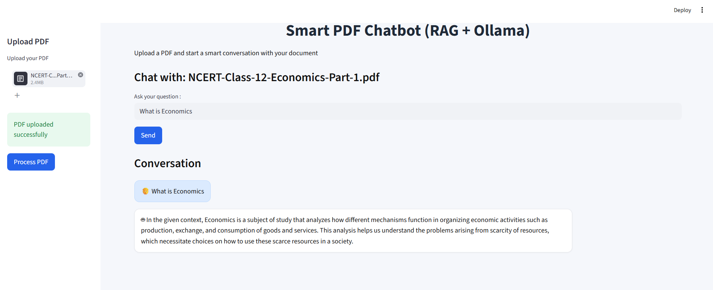
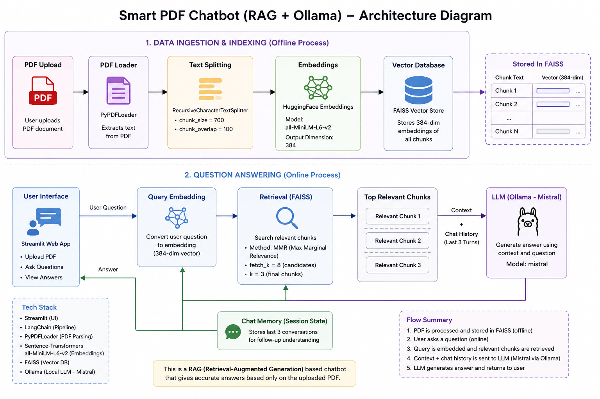

#  Smart PDF Chatbot (RAG + Ollama)

A **Retrieval-Augmented Generation (RAG)** based AI chatbot that allows users to upload any PDF and interact with it in a conversational way.
Built using **Streamlit, LangChain, FAISS, HuggingFace embeddings, and Ollama (local LLM)**.

---
<p align="center">
  
</p>

---

##  Features

-  Upload any PDF document
-  AI understands document content using embeddings
-  Chat with your PDF like a personal assistant
-  Context-aware answers using FAISS retrieval
-  Supports follow-up questions (memory enabled)
-  Runs locally using Ollama (no API cost)

---

##  Tech Stack

- Streamlit (Frontend UI)
- LangChain (RAG pipeline)
- FAISS (Vector database)
- HuggingFace Transformers (Embeddings)
- SentenceTransformers (all-MiniLM-L6-v2)
- Ollama (Local LLM - Mistral)
- PyPDF (PDF parsing)

---

## System Architecture

The following diagram explains the end-to-end workflow of the Smart PDF Chatbot using RAG and Ollama.



---

##  Setup Guide

### 1️ Clone the repository
```bash
git clone https://github.com/Ravi506051/RAG-based-PDF-chatbot-main.git
cd RAG-based-PDF-chatbot-main
```

### 2. Create and activate virtual environment

```bash
For Windows :
python -m venv venv
venv\Scripts\activate
```

### 3. Install Dependencies
```bash
pip install -r requirements.txt
```

### 4. Install Ollama (IMPORTANT)
Download Ollama:
 https://ollama.com

Then pull the model:
```bash
ollama pull mistral
```

Run Ollama (keep it running in background):
```bash
ollama run mistral
```
### 5. Run the Application
```bash
streamlit run app.py
```


## 🚀 Future Improvements

- Support multiple PDF documents in a single conversation
- Improve semantic search and document retrieval quality
- Add source references so users can verify answers against the original PDF
- Improve handling of long and complex documents
- Add chat history and a more user-friendly interface

## 🧪 Testing and Evaluation

Test the chatbot using PDFs with different topics and lengths. Ask factual questions, compare generated answers with the original document, and check whether the retrieved passages are relevant.

Useful evaluation measures include retrieval precision, answer relevance, and faithfulness to the source document.

## ⚠️ Limitations

- Answer quality depends on the quality of PDF text extraction and retrieval.
- Scanned PDFs may require OCR support.
- AI-generated answers should be checked against the original document.

## 👨‍💻 Project Maintainer

Ravi Kumar Rao

GitHub: https://github.com/Ravi506051
